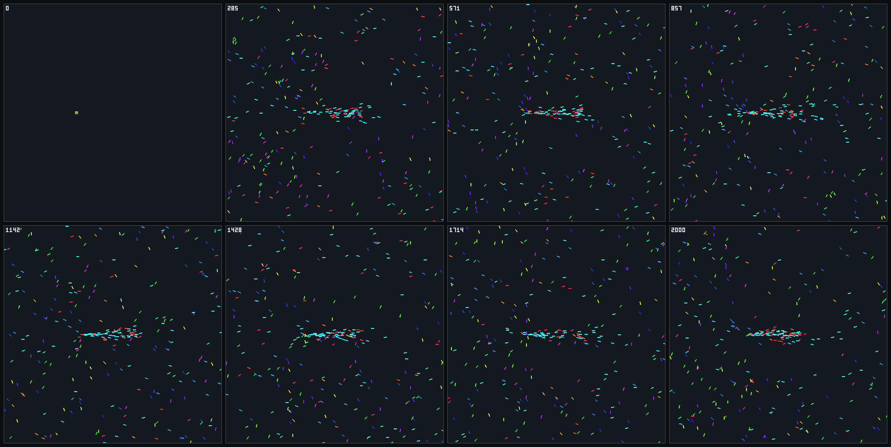
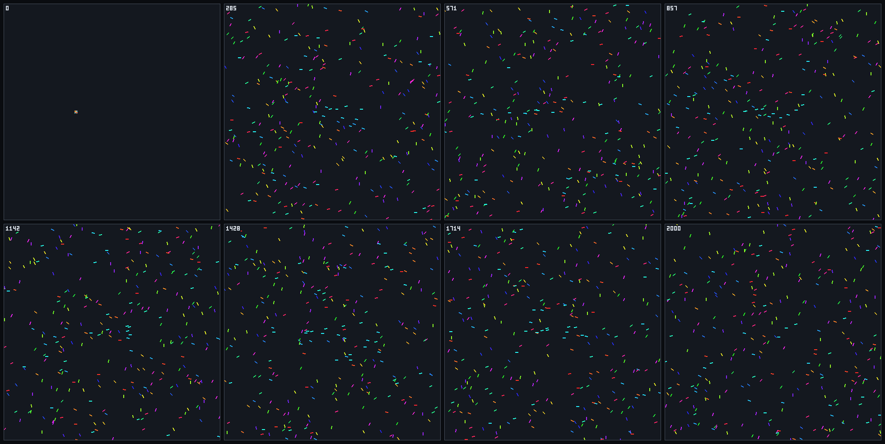

# Ant colony foundation

`AntColonyWorld` is the third foundation and the first with state that is not an agent. Ants lay a
scalar pheromone field, other ants read it, and more food reaches the nest than without it. This
closes the claim in [epic #10](https://github.com/Chris0Jeky/SwarmingLilMen/issues/10) that
materially different foundations run through one set of seams, with the qualifications in
[What the claim does and does not cover](#what-the-claim-does-and-does-not-cover).

This is a **foraging comparison, not an optimizer**. It makes no optimization-quality claim, solves
no TSP and finds no shortest path: there is one food source and returning ants already know the
way home. The seam inventory lives in [VICSEK.md](VICSEK.md#seam-inventory), now updated for ACO.

## Model

| Decision | Choice |
|---|---|
| Ant state | `Ant(Position, Heading, Carrying)`, not `Boid`. Velocity is derived from heading for analysis. |
| Searching | Sense left, centre and right, pick one in proportion to strength, turn by `SensorAngle` toward it, add wander, move. An empty field means wander alone. |
| Finding food | Inside the food circle with food left: take one unit. A contended last unit goes to the lowest index. |
| Returning | Steer straight to the nest by path integration across the torus, with no noise, buffering one deposit each tick. There is no home pheromone. |
| Delivering | Inside the nest circle: count one, then draw a fresh uniform heading. |
| Spawn | `aco-nest-v1`: every ant at the nest centre with a uniform heading from `aco.spawn` |
| Field | One `ScalarField`: fixed toroidal cells, nearest-cell read and write, no diffusion |
| Precision | Binary32 state; headings pass through platform trigonometry |

A delivered ant deliberately draws a new heading. Reversing would send it back along its own line
toward the food, which hands the control a route memory and contaminates the comparison. As built,
the field is the only information about where food is. No diffusion was needed: the metric cleared
its band without it.

### Phases

`Step()` calls two phases, in this order, and they refuse to run out of order.

```text
AgentPhase()   every ant in index order; reads field(t), buffers deposits, never writes the field
FieldPhase()   applies buffered deposits in ant order, then evaporates once
```

Food and delivery counters change in the agent phase, because they are resources rather than the
field. `FieldCadence` is recorded in every manifest and fixed at 1. Evaporation is geometric, and
values below `1e-30` flush to zero, because repeated multiplication otherwise stalls at the
smallest subnormal and a dead cell stays nonzero for ever.

### Random streams and the control

Each ant retains `RandomStreams.CreateStream("aco.forage", antId)`. This is the first real stress
test of the per-agent streams in [RANDOM_STREAMS.md](RANDOM_STREAMS.md), because draws depend on
state:

| Ant state | Draws this tick |
|---|---|
| Searching, every sensor reads zero | 1 (wander) |
| Searching, any sensor reads pheromone | 2 (wander, then the choice) |
| Returning | 0 |
| Delivering | 1 (the new heading) |

**The control.** Pheromone off is `Deposit = 0` in otherwise identical settings, on the same code
path. The field stays exactly zero, so the choice draw never happens. At the same seed, on and off
are bit-identical until the first tick that reads pheromone, and a test pins this. After that an ant
with pheromone has consumed an extra draw, so its later wander values come from a different point in
its stream. **Trajectories diverge once a turn decision reads pheromone; the runs are paired by seed
and spawn, not by noise.** Without pheromone an ant is also independent of the population: ant 0
follows the same bits alone or among 31 others while food is unlimited.

The stream contract needed no change. Construction derives one SHA-256 stream per ant, and warm
ticks allocate nothing.

## Run it

```powershell
dotnet run --project SwarmSim.Cli -c Release -- --engine aco --agents 300 --ticks 2000 --seed 7 --config scenarios/aco/base.json --metrics aco.foodReturned,aco.carrying,aco.fieldTotal --out runs --visual
dotnet run --project SwarmSim.Cli -c Release -- --sweep scenarios/aco/food-response.json --out runs
```

| Channel | Meaning |
|---|---|
| `aco.foodReturned` | Cumulative deliveries; exact integer |
| `aco.carrying` | Ants holding food now; exact integer |
| `aco.fieldTotal` | Sum of all cells in cell order |

The shared kinematic channels work too, but they describe all ants at once, so `polarization` says
little here. Name the `aco.*` channels explicitly; the default metric list does not include them.
Named `--scenario` recipes are boids tunings and are refused.

## Calibration

Everything below used seeds 1-5 only, at 2000 ticks in a 120 × 120 world. A coarse grid of 48
parameter combinations at 100 ants, then 18 finer combinations at 100 and 300 ants, chose the
recipe. Reach and sensor angle matter most.

| Parameter | Effect measured |
|---|---|
| `SensorDistance` 3 → 12 | Raises the ratio; 16 falls back |
| `SensorAngle` 0.4 → 1 | Raises the ratio |
| `Evaporation` 0.005-0.05 | Almost no effect: ensemble ratio 3.07-3.18 at the best setting then tested |
| `Deposit` amount | Not a real axis. The turn uses ratios between sensors, so only zero or nonzero matters until a cell nears the flush threshold. |

The chosen recipe is [`scenarios/aco/base.json`](../scenarios/aco/base.json): 300 ants, nest and
food 40 apart, `Evaporation` 0.01, `SensorAngle` 1, `SensorDistance` 12, `TurnNoise` 0.3 and a
2-unit cell. Ten cells take about 2 seconds in Release.

## Locked regression gate

`AntColonyCliTests.LockedRecipeReturnsMoreFoodWithPheromoneThanItsControl` runs the committed
[`food-response.json`](../scenarios/aco/food-response.json) through the real CLI sweep path, on food
returned at tick 2000.

| | Calibration, seeds 1-5 | **Locked band** | Regression, seeds 41-45 |
|---|---|---|---|
| On ÷ control, each seed | 4.61-4.93 | **≥ 3.5** | 4.49-4.90 |
| Ensemble ratio | 4.73 | **≥ 4.0** | 4.67 |
| Control food, each seed | 490-512 | **≥ 300** | 490-519 |

| Seed | On | Control | Ratio |
|---:|---:|---:|---:|
| 41 | 2300 | 509 | 4.519 |
| 42 | 2330 | 519 | 4.489 |
| 43 | 2450 | 500 | 4.900 |
| 44 | 2365 | 511 | 4.628 |
| 45 | 2367 | 490 | 4.831 |

Bands, recipe and seeds were committed in `61748c7` before seeds 41-45 first ran on this model. The
regression passed on its first run, and nothing moved. Two complete sweeps produced a byte-identical
`summary.csv`. Do not move these bands or change the seeds to make a failure pass.

## What the pictures show

Both films use seed 41 and the locked recipe. Colour is heading: red points east, cyan west.

**Pheromone on**



**Pheromone off**



Pheromone on shows a dense stream along the nest-to-food axis at every tick from 285 on, with cyan
ants returning west and red ants leaving east, inside a scattered background of searchers. Off, the
same seed stays diffuse for the whole run, with no line and only loose cyan ants heading home. At
tick 2000 the two films have returned 2300 and 509 units.

## Mutation witnesses

Each change was applied to the source, tested against the ACO and field tests, then restored.

| Mutation | Failing tests | Locked gate fails? |
|---|---:|---|
| Deposits ignored | 9 | Yes |
| Evaporation disabled | 2 | No |
| Sensors ignored | 5 | Yes |
| Field mutated during the agent phase | 2 | No |
| Evaporate before depositing | 1 | No |
| All ants share one stream | 3 | No |
| Choice draw taken every tick | 1 | No |
| Turn away from pheromone | 3 | Yes |
| Homing ignores the seam | 1 | No |
| Delivery not counted | 7 | Yes |
| Delivery reverses instead of drawing | 1 | No |
| Food never depletes | 4 | No |
| No subnormal flush | 1 | No |

All 13 fail, and the last column matters: **the A/B gate alone would miss nine of them**. It is a
behavioral result, not a model specification, so evaporation and phase order rest on the analytic
tests. Moving deposits into the agent phase lets the comparison pass while breaking the phase
contract, and only the phase tests see it.

The first driver run hung on `Deposits ignored`, because tests waited on `while` loops that a broken
model never satisfies. Those waits are now bounded and fail instead.

## Determinism

Repeats on one platform and runtime are exact: ants, every field cell, food counts and summary
bytes. Manifest replay verifies the kinematic hash and `metrics.csv`. **Hash version 1 does not
cover the field, loads or food**, and a test records that blindness. A divergence confined to the
field shows up only through later motion or a selected `aco.fieldTotal`, so field bits have their
own repeat test rather than a silently widened hash. No golden trace is committed, and the
[determinism bands](DETERMINISM.md) for boids do not extend here.

## What the claim does and does not cover

The shared part is the experiment spine, not the simulation loop.

- **Holds.** Three different state shapes and update rules run through one CLI registry, one metric
  plan, one RNG contract, one manifest and replay path, one sweep runner and one visual report.
  Adding ACO changed no line of `Canonical/`, legacy `World`, `Systems/` or `Vicsek/`.
- **Does not hold.** There is no kernel scheduler. The agent and field phases are distinct inside
  `AntColonyWorld`, and the CLI sees one `Step()`. A second field-based foundation would duplicate
  that ordering, and `ScalarField` is one concrete class with one consumer.

## Limits

- One recipe at one density and world size. No scaling, convergence or sensitivity study beyond the
  calibration above.
- Ants never lose a route: homing is exact and free. That is a modeling assumption, and it makes
  the trail strictly a recruitment signal, not a navigation aid for returning ants.
- Many ants never find the trail. The filmstrip shows a stream among a scattered background.
- Evaporation is close to invisible in the locked metric, since food never runs out there.
- The renderer has no ACO view, and the filmstrip draws neither the field, the nest nor the food
  (pheromone visualization is a stated non-goal).
- Windows x64 .NET 8 only so far; Linux runs through CI once this branch has a PR.
