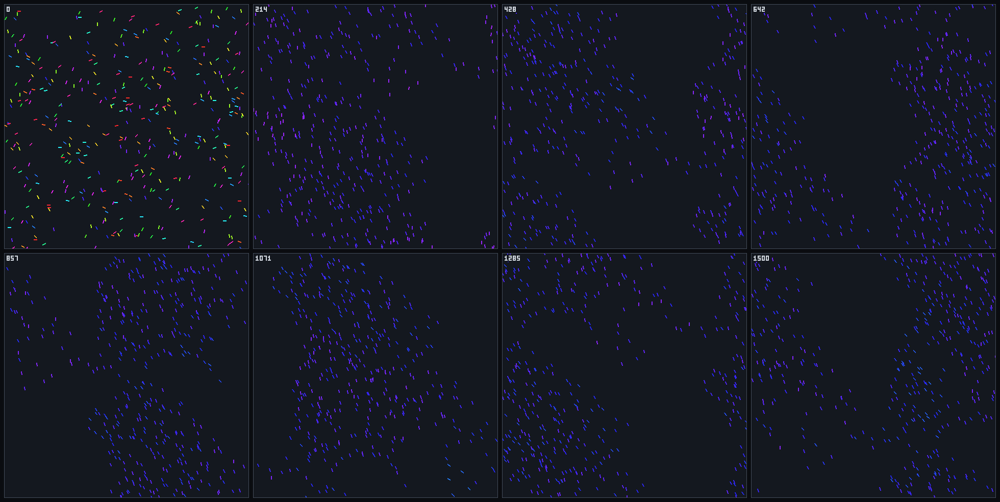
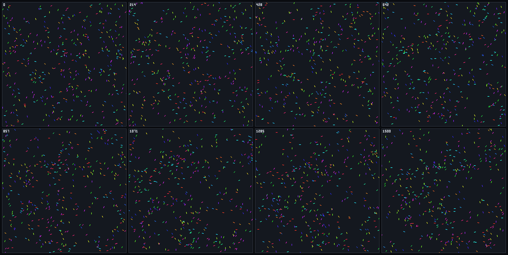

# Vicsek foundation and seam inventory

`VicsekWorld` is the second foundation in the C# engine and the first honest test of the kernel
claim in [epic #10](https://github.com/Chris0Jeky/SwarmingLilMen/issues/10). It shares kinematics
and neighborhood queries with boids and replaces all steering. The inventory below is the main
result: what the existing seams carried, what had to widen and what was bypassed.

This is a **finite noise-response result, not a phase-transition measurement**. No system-size or
convergence study has been run.

## Model

The target is the original model
([Vicsek et al. 1995](https://arxiv.org/abs/cond-mat/0611743), equations 1-3):

```text
x_i(t+1) = x_i(t) + v_i(t) dt                     old velocity
θ_i(t+1) = arg Σ_{j in r} v_j(t) + ξ_i(t)         old headings, self included once
ξ uniform on [-η/2, η/2), η in radians
```

| Decision | Choice |
|---|---|
| Update ordering | Synchronous double buffer. This differs from the sequential browser demo, which is a qualitative reference only. |
| Neighborhood | Inclusive radius on the torus, using the existing index contract |
| Truncation | None. The result buffer holds every agent, and a truncated query throws. |
| Zero resultant | When the mean velocity is below `1e-6 × Speed`, the agent keeps its own heading, then noise applies. |
| Noise schedule | One draw per agent per tick in index order, whatever the neighborhood, so runs differing only in η share a noise sequence |
| Streams | `vicsek.spawn` and `vicsek.noise`, derived from the run seed. Spawn is independent of η, so noise comparisons share initial state. |
| Precision | Binary32 state; the velocity sum and `atan2` use doubles |

The noise interval is half-open because the generator's float adapter is. Headings pass through
platform trigonometry, so exact traces are promised only for repeats on the same platform and
runtime. Vicsek has no committed golden trace.

## What it looks like

`--visual` renders any run. At low noise (η = 0.5) random headings become one coherent flock:



At high noise (η = 5) headings stay disordered:



## Run it

```powershell
dotnet run --project SwarmSim.Cli -c Release -- --engine vicsek --agents 400 --ticks 2000 --seed 7 --out runs
dotnet run --project SwarmSim.Cli -c Release -- --sweep scenarios/vicsek/noise-sweep.json --out runs
```

Native configuration uses `Noise`, `Speed`, `InteractionRadius`, `WorldWidth`, `WorldHeight`,
`FixedDeltaTime` and `Seed`. Defaults are the paper's r = 1, v = 0.03 and dt = 1 in a 10 × 10 box.
Named `--scenario` recipes are boids tunings and are refused for this engine. The order parameter
is the existing `polarization` channel, which a test pins to `|Σ v| / (N v0)`.

## Measured noise response

Exploratory `noise-sweep.json`: N = 400, L = 10, density 4, five seeds, mean order over ticks
2001-3000 on Windows x64 .NET 8.

| η (radians) | Mean | Seed min | Seed max |
|---:|---:|---:|---:|
| 0.05 | 1.000 | 1.000 | 1.000 |
| 0.2 | 0.998 | 0.998 | 0.998 |
| 0.5 | 0.987 | 0.986 | 0.988 |
| 1.0 | 0.946 | 0.942 | 0.949 |
| 2.0 | 0.790 | 0.772 | 0.797 |
| 3.0 | 0.560 | 0.552 | 0.581 |
| 4.0 | 0.267 | 0.224 | 0.320 |
| 5.0 | 0.067 | 0.062 | 0.070 |
| 2π | 0.045 | 0.043 | 0.046 |

At η = 2π the heading is independent of the neighborhood, and the measured value agrees with the
`0.886 / √N = 0.044` expected from random headings. The sweep ran once; its data supports a
smooth response at this size and says nothing about the order of the transition.

## Locked regression gate

`VicsekCliTests.LockedRecipeOrdersAtLowNoiseAndDisordersAtHighNoise` runs the committed
`noise-response.json` through the real sweep path. Its window is ticks 1001-2000.

| | Calibration, seeds 1-5 | **Locked band** | Regression, seeds 31-35 |
|---|---|---|---|
| η = 0.5, each seed | 0.988-0.989 | **≥ 0.95** | 0.988 at all five |
| η = 5, each seed | 0.124-0.152 | **≤ 0.25** | 0.126-0.136 |
| Ensemble difference | | **≥ 0.65** | 0.858 |

The recipe is N = 100, L = 5, density 4. An earlier locked 400-agent recipe on seeds 11-15 passed
but added 30 seconds to the test suite, so it was replaced for cost, not because of a failure. The
replacement bands were recalibrated on seeds 1-5 and committed in `0cb7a8f` before seeds 31-35
first ran. Do not move these bands or change the seeds to make a failure pass.

Two complete runs of the recipe produced a byte-identical `summary.csv`.

## Mutation witnesses

Each change was applied to `VicsekWorld.cs`, tested, then restored.

| Mutation | Failing tests |
|---:|---|
| Ignore neighbors | 6, including the locked gate |
| Remove noise | 3, including the locked gate |
| Treat η as a fraction of 2π | 2, including the locked gate |
| Count self twice | 5 |
| Read neighbors updated earlier in the tick | 3 |
| Advance position with the new velocity | 1 |
| Draw noise only for agents with neighbors | 1 |

The last mutation first survived, because `Assert.Equal(float, float, 5f)` is a tolerance of five
rather than five decimal places. The assertions now pass an integer precision.

## Seam inventory

**Boids stayed untouched.** `Canonical/`, legacy `World` and `Systems/` have no changes, and the
exact boids goldens still pass.

### Reused unchanged

| Seam | How Vicsek uses it |
|---|---|
| `ISpatialIndex`, `GridSpatialIndex`, `NaiveSpatialIndex` | Stores `Boid` values directly. Grid and naive runs have identical hashes for 128 noisy ticks. |
| `RandomStreams`, `Pcg32Rng` | Two named world streams |
| `Boid`, `Vec2`, `MathUtils.WrapPosition` | Position, velocity and the periodic box |
| `MotionMetricProbe` and exact nearest-neighbor probe | All channels work unchanged. `polarization` is the order parameter. |
| `MetricRegistry`, `MetricCsvWriter`, `ExperimentMetrics` | No change |
| `ExperimentRunner` staging, publish and replay verification | Reads the per-engine spawn model; otherwise unchanged |
| `SweepRunner`, `SweepSummary` | No change; `Noise` is an ordinary numeric axis |

### Widened

| Seam | Change | Finding |
|---|---|---|
| `SimulationKinematicHash` | New overload sharing one span helper | Version-1 bytes are unchanged |
| `ConfigurationResolver` | `ResolveVicsekSettings` on the existing generic layering | The private `canonical` flag and the boids-only scenario table are not foundation-neutral |
| `RunManifest` | Spawn model is per engine; Vicsek requires schema 2 | Replay had assumed a single spawn model |
| `RunRequest`, `PreparedSimulation`, `RunOptions`, `MetricCatalog`, `SweepPlan` | One more branch in each | **Engine is a closed list spread across seven CLI files.** Two engines hid this; a fourth would pay for all of it again. |

### Bypassed

| Seam | Why |
|---|---|
| `CanonicalWorld.Step` and force composition | Vicsek replaces a heading. Force policies, resolvers and velocity stages cannot express that, which confirms the gap recorded in #27. |
| `SimulationRunner` | It is typed on legacy `World`, and no headless engine uses it. The CLI loop is the actual headless scheduler. |
| `PreparedSimulation.Spawn` | Boids spawning uses legacy `Rng`; new consumers use named streams. |
| Named scenarios and the parity harness | Both are boids-specific |

### What was not earned

`ISpatialIndex` stays typed on `Boid`. The issue allowed generalizing it here, but Vicsek agents
have the same position and velocity shape, so a type parameter would solve nothing yet. `Boid`
carries an unused `Group` byte in this foundation. Agent-state generics stay deferred until a
foundation has a genuinely different shape.

The next candidate is a small simulation interface over `Step`, `Capture`, `KinematicHash`, extents
and capacity to replace the seven-file branching. Three foundations will justify it; ACO (#30)
should make that call from its own needs.

## Limits

- Noise response at one density and two sizes only; no finite-size scaling or Binder cumulant.
- The renderer has no Vicsek view (a stated non-goal).
- No throughput target. The sweep above took 156 seconds for 45 runs on a busy desktop, so ordered
  flocks are not cheap: clumping raises neighbor counts well above the mean density.
- The legacy and canonical determinism bands in [determinism](DETERMINISM.md) do not extend here.
