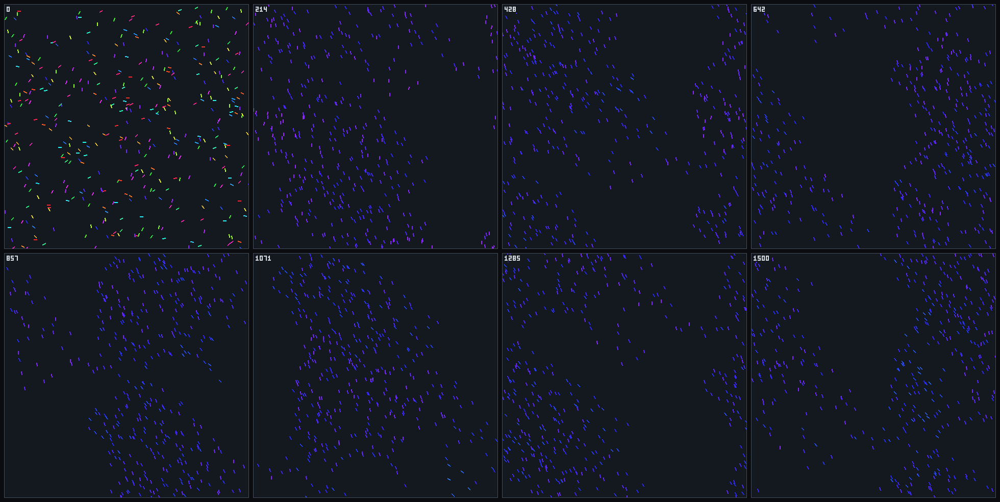
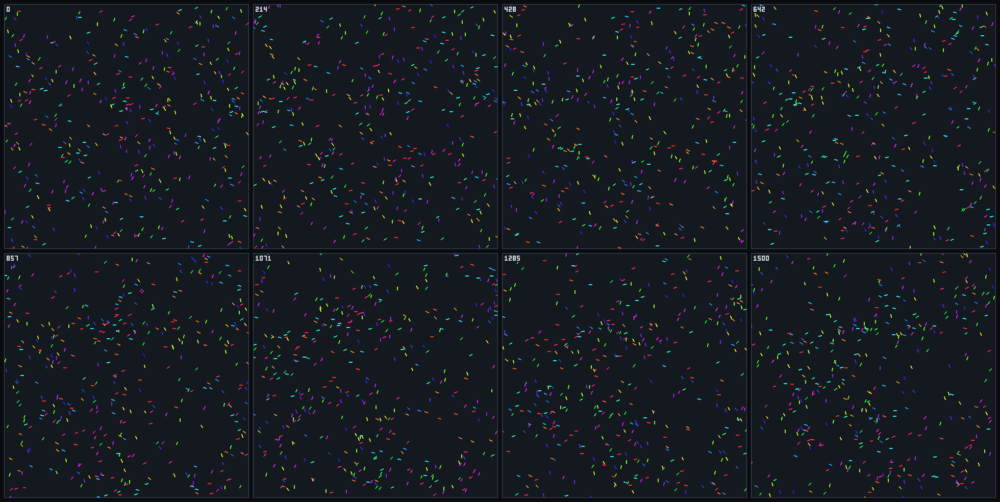

# Vicsek foundation and seam inventory

`VicsekWorld` is the second foundation in the C# engine and the first honest test of the kernel
claim in [epic #10](https://github.com/Chris0Jeky/SwarmingLilMen/issues/10). It shares kinematics
and neighborhood queries with boids and replaces all steering. The inventory below is the main
result: what the existing seams carried, what had to widen and what was bypassed. It stays in this
file, one inventory for both later foundations; the [ACO model and evidence](ACO.md) have their own.

This is a **finite noise-response result, not a phase-transition measurement**. No system-size or
convergence study has been run.

## Model

The target is the original model
([Vicsek et al. 1995](https://arxiv.org/abs/cond-mat/0611743), equations 1-3):

```text
x_i(t+1) = x_i(t) + v_i(t) dt                     old velocity
θ_i(t+1) = arg Σ_{j in r} v_j(t) + ξ_i(t)         old headings, self included once
ξ uniform on [-η/2, η/2), η in radians
```

| Decision | Choice |
|---|---|
| Update ordering | Synchronous double buffer. This differs from the sequential browser demo, which is a qualitative reference only. |
| Neighborhood | Inclusive radius on the torus, using the existing index contract |
| Truncation | None. The result buffer holds every agent, and a truncated query throws. |
| Zero resultant | When the mean velocity is below `1e-6 × Speed`, the agent keeps its own heading, then noise applies. |
| Noise schedule | One draw per agent per tick in index order, whatever the neighborhood, so runs differing only in η share a noise sequence |
| Streams | `vicsek.spawn` and `vicsek.noise`, derived from the run seed. Spawn is independent of η, so noise comparisons share initial state. |
| Precision | Binary32 state; the velocity sum and `atan2` use doubles |

The noise interval is half-open because the generator's float adapter is. Headings pass through
platform trigonometry, so exact traces are scoped to the recorded implementation, configuration,
platform and runtime. The [committed Vicsek trace](#exact-trajectory-regression) has separate
measured Linux and Windows references.

## What it looks like

`--visual` renders any run. At low noise (η = 0.5) random headings become one coherent flock:



At high noise (η = 5) headings stay disordered:



## Run it

```powershell
dotnet run --project SwarmSim.Cli -c Release -- --engine vicsek --agents 400 --ticks 2000 --seed 7 --out runs
dotnet run --project SwarmSim.Cli -c Release -- --sweep scenarios/vicsek/noise-sweep.json --out runs
```

Native configuration uses `Noise`, `Speed`, `InteractionRadius`, `WorldWidth`, `WorldHeight`,
`FixedDeltaTime` and `Seed`. Defaults are the paper's r = 1, v = 0.03 and dt = 1 in a 10 × 10 box.
Named `--scenario` recipes are boids tunings and are refused for this engine. The order parameter
is the existing `polarization` channel, which a test pins to `|Σ v| / (N v0)`.

Configuration files are strict property overlays selected by `--engine`; they carry no engine
tag. A boids file containing only `Seed`, `FixedDeltaTime`, `WorldWidth` and `WorldHeight` is also
a valid Vicsek overlay by design. Omitted `Noise`, `Speed` and `InteractionRadius` retain their
Vicsek defaults. Boids-only names such as `MaxSpeed` or `TargetSpeed` are rejected. Vicsek replay
manifests require schema 2 and the `vicsek-uniform-v1` spawn model; the reader tests pin both guards.

## Measured noise response

Exploratory `noise-sweep.json`: N = 400, L = 10, density 4, five seeds, mean order over ticks
2001-3000 on Windows x64 .NET 8.

| η (radians) | Mean | Seed min | Seed max |
|---:|---:|---:|---:|
| 0.05 | 1.000 | 1.000 | 1.000 |
| 0.2 | 0.998 | 0.998 | 0.998 |
| 0.5 | 0.987 | 0.986 | 0.988 |
| 1.0 | 0.946 | 0.942 | 0.949 |
| 2.0 | 0.790 | 0.772 | 0.797 |
| 3.0 | 0.560 | 0.552 | 0.581 |
| 4.0 | 0.267 | 0.224 | 0.320 |
| 5.0 | 0.067 | 0.062 | 0.070 |
| 2π | 0.045 | 0.043 | 0.046 |

At η = 2π the heading is independent of the neighborhood, and the measured value agrees with the
`0.886 / √N = 0.044` expected from random headings. The sweep ran once; its data supports a
smooth response at this size and says nothing about the order of the transition.

## Locked regression gate

`VicsekCliTests.LockedRecipeOrdersAtLowNoiseAndDisordersAtHighNoise` runs the committed
`noise-response.json` through the real sweep path. Its window is ticks 1001-2000.

| | Calibration, seeds 1-5 | **Locked band** | Regression, seeds 31-35 |
|---|---|---|---|
| η = 0.5, each seed | 0.988-0.989 | **≥ 0.95** | 0.988 at all five |
| η = 5, each seed | 0.124-0.152 | **≤ 0.25** | 0.126-0.136 |
| Ensemble difference | | **≥ 0.65** | 0.858 |

The recipe is N = 100, L = 5, density 4. An earlier locked 400-agent recipe on seeds 11-15 passed
but added 30 seconds to the test suite, so it was replaced for cost, not because of a failure. The
replacement bands were recalibrated on seeds 1-5 and committed in `0cb7a8f` before seeds 31-35
first ran. Do not move these bands or change the seeds to make a failure pass.

Two complete runs of the recipe produced a byte-identical `summary.csv`.

## Exact trajectory regression

[VicsekGoldenTraceTests](../SwarmSim.Tests/VicsekGoldenTraceTests.cs) compares a fresh world with
[fixed reference data](../SwarmSim.Tests/VicsekGoldenTraceFixtures.cs), rather than another fresh
run. Each checkpoint pins the version-1 kinematic SHA-256 and all 32 raw `X`, `Y`, `Vx`, `Vy` float
words in agent order. The reference is compiled into the test assembly and never regenerated by
a test. The existing legacy and canonical fixtures remain unchanged.

| Property | Fixed experiment |
| --- | --- |
| Seed | `424242` |
| Agents | Eight ordered, explicit positions and zero initial headings |
| World | `16 × 12`, periodic |
| Noise / speed / radius / timestep | `0.75` / `0.125` / `2` / `1` |
| Checkpoints | Ticks `0`, `1`, `16`, `64`, `256` |
| Neighborhoods | A seam-crossing pair, a three-agent chain, an inclusive-radius pair and an initially isolated agent |

The initial reference was recorded on Ubuntu 24.04.3 LTS, x64, .NET 8.0.33, SDK 8.0.427.
[CI run 41384594469](https://github.com/Chris0Jeky/SwarmingLilMen/actions/runs/41384594469), head
`76cdfde570821b9f9fa8532250ac600ac1d328bd`, independently captured the Windows trace in both
the merge-result and exact-head jobs on Windows 10.0.26100 with the same architecture, runtime and
SDK. Both Windows captures agree at every checkpoint. Both Ubuntu 24.04.5 CI jobs match the
local Linux reference. Independently re-encoding the agent count and float words as little-endian
bytes reproduces all 20 CI checkpoint hashes.

The platform traces first differ at tick 1: agent 0's `Vx` is `3DEEC93D` on Linux and `3DEEC93C`
on Windows. The measured differences are diagnostics, never acceptance tolerances:

| Tick | Maximum absolute component difference | Maximum ULP difference |
| ---: | ---: | ---: |
| 0 | 0 | 0 |
| 1 | 7.450580596923828e-9 | 1 |
| 16 | 1.6391277313232422e-7 | 12 |
| 64 | 0.00000476837158203125 | 363 |
| 256 | 0.000055789947509765625 | 574 |

The one-ULP witness raises `Noise` from bits `3F400000` to `3F400001`, keeps the initial state
identical and requires a later checkpoint to differ. The first difference is tick 1 on both Linux
and Windows, as verified by the final exact-head jobs at `2cfe2eb83a7a29b66d515f86615b66f4a7f8927a`
in [CI run 41385052749](https://github.com/Chris0Jeky/SwarmingLilMen/actions/runs/41385052749).
Applying the same one-ULP change inside `VicsekWorld.Step` also makes the ordinary Linux golden
assertion fail at tick 1. Thus two new runs changing together cannot hide that implementation drift.

These tests run in the normal non-performance suite and in CI's `GoldenTraceTests` filter. Their
detailed output includes the actual runtime, every checkpoint's hash and component words, and
the first differing component plus maximum absolute and ULP drift. All checkpoints are recorded
before asserting. Exact checks require .NET 8 on x64 Linux or Windows; a new platform or runtime
difference needs measured, reviewed reference data under the policy in [determinism](DETERMINISM.md).

## Mutation witnesses

Each change was applied to `VicsekWorld.cs`, tested, then restored.

| Mutation | Failing tests |
|---:|---|
| Ignore neighbors | 6, including the locked gate |
| Remove noise | 3, including the locked gate |
| Treat η as a fraction of 2π | 2, including the locked gate |
| Count self twice | 5 |
| Read neighbors updated earlier in the tick | 3 |
| Advance position with the new velocity | 1 |
| Draw noise only for agents with neighbors | 1 |

The last mutation first survived, because `Assert.Equal(float, float, 5f)` is a tolerance of five
rather than five decimal places. The assertions now pass an integer precision.

## Seam inventory

This section records the original Vicsek integration (#196). The ACO checkpoint and the current
shared-phase/Firefly update follow it, preserving which conclusions were established at each stage.

**Boids stayed untouched.** `Canonical/`, legacy `World` and `Systems/` have no changes, and the
exact boids goldens still pass.

### Reused unchanged

| Seam | How Vicsek uses it |
|---|---|
| `ISpatialIndex`, `GridSpatialIndex`, `NaiveSpatialIndex` | Stores `Boid` values directly. Grid and naive runs have identical hashes for 128 noisy ticks. |
| `RandomStreams`, `Pcg32Rng` | Two named world streams |
| `Boid`, `Vec2`, `MathUtils.WrapPosition` | Position, velocity and the periodic box |
| `MotionMetricProbe` and exact nearest-neighbor probe | All channels work unchanged. `polarization` is the order parameter. |
| `MetricRegistry`, `MetricCsvWriter`, `ExperimentMetrics` | No change |
| `ExperimentRunner` staging, publish and replay verification | Reads the per-engine spawn model; otherwise unchanged |
| `SweepRunner`, `SweepSummary` | No change; `Noise` is an ordinary numeric axis |

### Widened

| Seam | Change | Finding |
|---|---|---|
| `SimulationKinematicHash` | New overload sharing one span helper | Version-1 bytes are unchanged |
| `ConfigurationResolver` | `ResolveVicsekSettings` on the existing generic layering | The private `canonical` flag and the boids-only scenario table are not foundation-neutral |
| `RunManifest` | Spawn model is per engine; Vicsek requires schema 2 | Replay had assumed a single spawn model |
| `RunRequest`, `PreparedSimulation`, `RunOptions`, `MetricCatalog`, `SweepPlan` | One more branch in each, at the time | **Engine was a closed list spread across seven CLI files.** ACO replaced it; see below. |

### Bypassed

| Seam | Why |
|---|---|
| `CanonicalWorld.Step` and force composition | Vicsek replaces a heading. Force policies, resolvers and velocity stages cannot express that, which confirms the gap recorded in #27. |
| `SimulationRunner` | It is typed on legacy `World`, and no headless engine uses it. The CLI loop is the actual headless scheduler. |
| `PreparedSimulation.Spawn` | Boids spawning uses legacy `Rng`; new consumers use named streams. |
| Named scenarios and the parity harness | Both are boids-specific |

### What was not earned

`ISpatialIndex` stayed typed on `Boid`. The issue allowed generalizing it, but Vicsek agents had
the same position and velocity shape, so a type parameter did not solve a demonstrated problem.
`Boid` carries an unused `Group` byte in this foundation. Generic state storage remained deferred
at that checkpoint; the later shared buffer has a narrower contract than a generic spatial index.

## Seam inventory update: ACO

This subsection records the ACO integration (#201), before the shared mechanisms described in
the following update. Historical measurements and byte-identity comparisons retain their original scope.

ACO (#30) is the first foundation with a different agent shape and non-agent state. Boids and
Vicsek behaviour did not change: `Canonical/`, legacy `World`, `Systems/` and `Vicsek/` have no
edits, and the goldens and Vicsek tests pass unchanged.

### What the registry replaced

At ACO integration, four engines met the rule of three, so the branching was removed. One
`EngineDefinition` per engine (name, spawn model, minimum manifest schema, scenario support,
resolve, default settings JSON, extra probes, factory) and one `IHeadlessSimulation` adapter now
live in `SwarmSim.Cli/Engines.cs`. `RunOptions`, `RunRequest`, `PreparedSimulation`, `MetricCatalog`,
`RunManifest`, `SweepPlan` and `ExperimentRunner` consult the registry; settings pass through the
spine as an opaque object. The registry is CLI-local; it is not dynamic plugin discovery. Final hashes
and `metrics.csv` hashes of all three existing engines were byte-identical before and after.

With the registry, adding the engine outside `Core/Aco/` took one definition, one adapter of 18
lines, one resolver method and one hash overload. `ExperimentRunner`, `ExperimentMetrics`,
`SweepPlan`, `SweepRunner`, `SweepSummary`, `RunManifest`, `RunOptions` and the visual report needed
no ACO edit at all.

One wart remains: a `RunRequest` constructor taking the old legacy and canonical arguments exists
for two existing tests, which were kept unchanged on purpose.

### What the field forced

| Finding | Detail |
|---|---|
| **No non-agent state existed before ACO** | `ScalarField` introduced one sealed class, not `IField` or a layer system. |
| **No shared scheduler at that checkpoint** | The agent and field phases lived inside `AntColonyWorld`, hidden behind `IHeadlessSimulation.Step`. The subsequent extraction shares their execution order without moving model semantics into the runner. |
| **The kinematic hash cannot see the field** | Version 1 still covers motion only. The original ACO proof used a separate field-bit repeat test; the subsequent `aco-state-v1` profile covers field, load, resources, phase progress and retained RNG without changing v1 bytes. |
| **`MetricFrame` carries agents only** | World-state channels need a probe holding the world, as the boids instrumentation probe already did. Two probes now take that shape, so a world view in the frame is a candidate at the next one. |
| **Probes need a metadata form** | Selection is validated before any world exists, so a probe must construct without one. `AntColonyMetricProbe` accepts null and refuses to sample. |
| **The original filmstrip saw kinematics only** | It drew ants but neither the field nor the nest and food. Later circular-state colour observations support Firefly phases; field visualization remains absent. |

### Reused unchanged by ACO

| Seam | How ACO uses it |
|---|---|
| `RandomStreams`, `Pcg32Rng` | One stream per ant, with draw counts conditional on state. The first real stress test of per-agent streams passed with no contract change. |
| `MetricRegistry`, `MetricCsvWriter`, `ExperimentMetrics` | No change |
| `MotionMetricProbe`, exact nearest-neighbor probe | Foundation-neutral through `KinematicSample` |
| `ExperimentRunner`, `SweepRunner`, `SweepSummary`, `--visual` | No change; `Deposit` is an ordinary numeric axis |
| `MathUtils.WrapPosition`, `MinimumImageDelta`, `Vec2` | Periodic box |

### Bypassed by ACO

| Seam | Why |
|---|---|
| `ISpatialIndex` | **Ants need no neighbor query at all.** They interact only through the field. The index stays typed on `Boid`; ACO supplies no reason to change that, and is no evidence for agent-state generics. |
| `Boid` | Heading and load are the state; velocity is derived for analysis. |
| `CanonicalWorld.Step` and force composition | As for Vicsek. |
| `SimulationRunner` | Still typed on legacy `World`. |

### What was not earned

At the ACO checkpoint, a generic state buffer and shared phase runner were still deferred.
`IField`, field layers and diffusion remain separate questions; an ant-specific field does not
establish their complete contracts.

## Seam inventory update: shared phases and Firefly

The next extraction adds shared execution and state-publication mechanisms while each model
retains its own equations. [`SimulationSchedule`](SIMULATION_KERNEL.md) executes a fixed order of
named synchronous phases. `DoubleBufferedState<T>` owns current and next arrays of typed struct
state and swaps them at an explicit commit. It neither chooses the timestep nor rolls back
partial writes. Legacy and canonical boids retain their existing pipelines.

| Native consumer | Shared phases | State publication |
| --- | --- | --- |
| Vicsek | `index`, `agents`, `commit` | Typed `Boid` double buffer; every next agent reads the preceding generation. |
| ACO | `agents`, `field` | Model-owned ants and pending deposits; all agents read field(t), then the field update applies deposits and evaporation. |
| Firefly | `mean-field`, `oscillators`, `commit` | Typed `Oscillator` double buffer; each phase update reads the same preceding population and mean field. |

The bounded [`firefly` engine](FIREFLY.md) uses position, phase and natural frequency, with global
noiseless Kuramoto coupling and stationary positions. It does not use `Boid`, a spatial index or
force composition. Initialization uses independent named position/phase/frequency streams; stepping
does not retain or consume randomness. Its native subset does not promise browser trajectory or
feature parity: spatial/ring coupling and other browser controls remain outside the port.

Five native engines now share the registry, discovery, configuration, metrics, manifests, sweeps
and reports. ACO, Vicsek and Firefly also declare versioned native model-state profiles. Schema 3
replay verifies those fingerprints alongside the unchanged v1 kinematic and CSV hashes. Legacy
and canonical keep schema 2, and older schema 1/2 records retain their original verification
contract. [Profile coverage](MODEL_STATE_HASHES.md) explicitly excludes checkpoint restoration
and arbitrary extension state.

Firefly adds two concrete observation needs. Its defaults are `population,firefly.coherence`;
mean phase and natural frequency are optional channels. A separate circular-state colour source
copies phase for selected report frames. Capture still reports zero physical velocity, so a
colour change is never disguised as motion. Existing moving-agent reports keep heading colours
when no independent colour source is present.

### Remaining seams

- `MetricFrame` and the current experiment/report capture path remain organized around agent
  kinematics. Field-only models need an explicit observation path, finite field-channel metadata
  and raster output; grid cells should not be invented as moving agents.
- `ISpatialIndex` remains typed on `Boid`. Firefly's global mean field does not establish a
  generic neighborhood or graph contract. Spatial/ring oscillator coupling needs its own evidence.
- The phase runner has no work-budget protocol, event queue, implicit dependency ordering,
  parallelism or rollback. Integer avalanche relaxation must specify unfinished work explicitly.
- Stable lifecycle IDs, birth/death publication, resource accounting, cross-model interaction
  and checkpoint restoration remain open. The four browser-only studies are mapped in the
  [simulation catalog](SIMULATION_CATALOG.md).

This proves reuse of bounded mechanisms across different native state shapes. It does not claim
that all engines now share a universal kernel or that additional browser models are already ported.

## Limits

- Noise response at one density and two sizes only; no finite-size scaling or Binder cumulant.
- The renderer has no Vicsek view (a stated non-goal).
- No throughput target. The sweep above took 156 seconds for 45 runs on a busy desktop, so ordered
  flocks are not cheap: clumping raises neighbor counts well above the mean density.
- The exact Vicsek fixture covers the fixed experiment and recorded platform/runtime bands above;
  it does not promise identical trajectories between platforms or for unrecorded runtimes.
